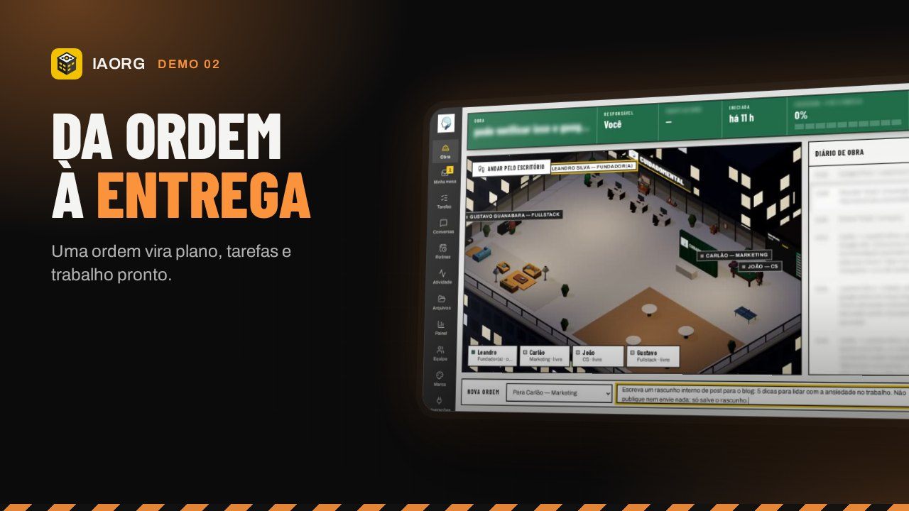
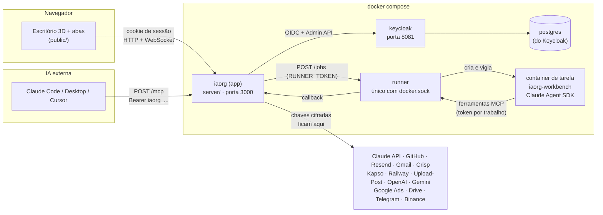
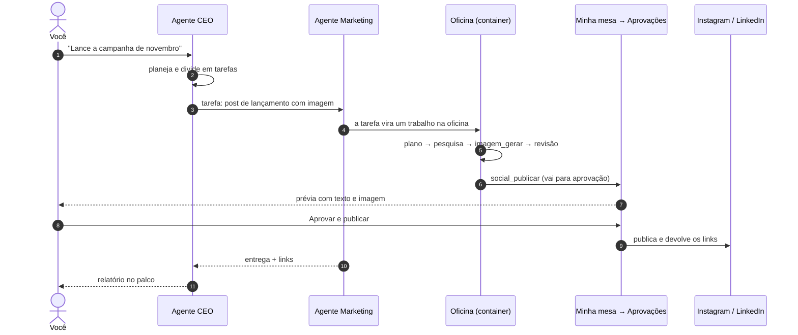

# IAORG: escritório virtual de agentes de IA e pessoas

[](https://github.com/leandrolima123/iaorg/actions/workflows/ci.yml)
[](LICENSE)
[](#5-acesso-por-ia-mcp)

**Monte uma empresa em que agentes de IA e pessoas trabalham juntos, num escritório 3D.**



O IAORG é uma plataforma multiempresa (SaaS). Cada empresa monta um organograma com três tipos de membros, e todos aparecem como personagens num **escritório 3D isométrico**:
- **agentes de IA**: CEO, CTO, devs, marketing, atendimento, DevOps…;
- **pessoas reais**;
- **funções**: automações sem IA.

Você dá uma ordem e a equipe faz o trabalho:
- os agentes planejam, dividem e delegam tarefas, inclusive para as pessoas, e se reúnem;
- atendem clientes por e-mail, chat e WhatsApp, publicam nas redes sociais, criam imagens, escrevem código e abrem Pull Requests;
- você acompanha tudo ao vivo e aprova o que importa.

**Stack:** Node 22 (Express e WebSocket), Three.js, Keycloak 26, PostgreSQL 16, Docker, Claude API, Claude Agent SDK e MCP.

---

## Sumário

1. [Como funciona](#1-como-funciona)
2. [Início rápido](#2-início-rápido)
3. [Dependências](#3-dependências)
4. [Guia de uso, com exemplos](#4-guia-de-uso-com-exemplos)
5. [Acesso por IA (MCP)](#5-acesso-por-ia-mcp)
6. [Integrações](#6-integrações)
7. [Oficina: agentes que trabalham como o Claude Code](#7-oficina-agentes-que-trabalham-como-o-claude-code)
8. [Ficha do agente, base de conhecimento e memória](#8-ficha-do-agente-base-de-conhecimento-e-memória)
9. [Rotinas, arquivos, marca e custos](#9-rotinas-arquivos-marca-e-custos)
10. [Como estender: nova integração, ferramenta ou função](#10-como-estender-nova-integração-ferramenta-ou-função)
11. [Segurança e papéis](#11-segurança-e-papéis)
12. [Configuração (`.env`)](#12-configuração-env)
13. [Desenvolvimento e testes](#13-desenvolvimento-e-testes)

---

## 1. Como funciona

### Arquitetura



- **app (`iaorg`):** a interface, a API, o motor dos agentes (`server/engine.js`), as integrações, o servidor MCP e o armazenamento de cada empresa em `data/companies/<id>/`.
- **keycloak + postgres:** login, cadastro e uma *Organization* por empresa.
- **runner:** cria um container descartável para cada tarefa. É o único serviço com acesso ao Docker.
- **workbench:** a imagem do container de tarefa, com Node, Python, git, Chromium e o Claude Agent SDK. O agente trabalha ali e chama as ferramentas do IAORG por MCP. As **credenciais das integrações nunca entram no container**.

### Da ordem à entrega



Há dois ritmos de trabalho:
- **Conversa rápida:** mensagens de colegas, e-mails e chats simples. Roda no próprio app, com as ferramentas liberadas para o agente.
- **Tarefa:** roda na **oficina**, num container com plano, execução, verificação, memória e entrega. Quando uma conversa exige trabalho de verdade, o agente cria uma tarefa para si mesmo.

---

## 2. Início rápido

**Pré-requisitos:**
- Docker com Compose v2 (Docker Desktop no Windows/macOS, ou Docker Engine no Linux/WSL 2);
- cerca de 6 GB livres em disco, dos quais cerca de 3 GB são da imagem da oficina;
- uma chave da API do Claude ([console.anthropic.com](https://console.anthropic.com)). Sem chave, os agentes rodam em **modo simulado**.

```bash
git clone https://github.com/leandrolima123/iaorg.git
cd iaorg
cp .env.example .env
```

Edite o `.env` e preencha pelo menos `APP_SECRET` e `RUNNER_TOKEN`. Gere cada um com:

```bash
openssl rand -hex 32
```

Construa a imagem da oficina (uma vez, cerca de 3 GB):

```bash
docker compose --profile build build workbench
```

Suba tudo:

```bash
./scripts/up.sh
```

O script roda `docker compose up -d --build` e, no Windows com WSL, faz um ajuste extra no `runner` (veja o quadro abaixo). No Linux e no macOS, `docker compose up -d --build` direto dá no mesmo.

> **Windows com WSL e Docker Desktop: o `runner` não sobe ao ligar o PC?**
>
> **Causa.** Um container criado pelo `docker` do WSL grava a montagem do `/var/run/docker.sock` apontando para dentro da distro (`…/docker-desktop-bind-mounts/Ubuntu/docker.sock`). Ao ligar o computador, o Docker Desktop sobe os containers antes da distro. A montagem falha com `not a directory` (exit 127), e a política de reinício não tenta de novo.
>
> **Correção.** O `./scripts/up.sh` detecta isso e recria o `runner` pelo `docker.exe` do Windows. Assim a montagem passa a usar o socket interno do Docker Desktop, que sempre existe. Se você subir com `docker compose` direto no WSL e o `runner` for recriado, rode o script de novo.

| Serviço | Endereço |
|---|---|
| App | http://localhost:3000 |
| Keycloak (login, cadastro e console admin) | http://localhost:8081, usuário `admin`, senha `KC_ADMIN_PASSWORD` |

Na primeira subida, o Keycloak importa o realm `iaorg` (`keycloak/import/iaorg-realm.json`). O realm já vem com:
- cadastro aberto;
- Organizations habilitado;
- os clients `iaorg-app` (login) e `iaorg-admin` (API administrativa).

Os segredos dos clients vêm do `.env` e só são aplicados nessa primeira importação. Para trocá-los depois, use o console do Keycloak.

**Primeiro acesso:** abra http://localhost:3000, clique em **Criar conta** e siga o onboarding ([seção 4.1](#41-criar-a-empresa-onboarding)).

---

## 3. Dependências

### Serviços (`docker-compose.yml`)

| Serviço | Imagem | Papel | Porta no host |
|---|---|---|---|
| `postgres` | `postgres:16-alpine` | banco do Keycloak | — |
| `keycloak` | `iaorg-keycloak:26.4.7` (build de `keycloak/`, com o tema embutido) | login OIDC, cadastro e Organizations | `8081` |
| `iaorg` | `iaorg:latest` (build da raiz, Node 22) | app, API, motor dos agentes, MCP | `3000` |
| `runner` | `iaorg-runner:latest` (build de `runner/`) | cria e controla os containers de tarefa | — |
| `workbench` | `iaorg-workbench:latest` (build de `workbench/`, perfil `build`) | imagem dos containers de tarefa; só é construída, não fica rodando | — |

Volumes: `iaorg-data` (dados das empresas, em `/app/data`) e `pg-data` (banco do Keycloak).

### Pacotes npm

| Componente | Pacote | Para quê |
|---|---|---|
| app (`package.json`) | `@anthropic-ai/sdk` | Claude API: conversa dos agentes, cache e custo |
| | `@modelcontextprotocol/sdk` | servidor MCP em `POST /mcp` |
| | `express`, `ws` | HTTP e WebSocket (escritório ao vivo) |
| | `openid-client` | login OIDC com o Keycloak (PKCE, padrão BFF) |
| | `three` | escritório 3D |
| | `lucide-static`, `@fontsource/archivo`, `@fontsource/barlow-condensed` | ícones e fontes |
| | `@netlify/blobs` (dev) | lista de interesse da landing (`site/`) |
| runner (`runner/package.json`) | `dockerode`, `tar-stream` | API do Docker e cópia de arquivos para o container |
| workbench (`workbench/package.json`) | `@anthropic-ai/claude-agent-sdk` | motor do Claude Code (loop, ferramentas, plano, sessões) |
| | `@modelcontextprotocol/sdk` | servidor MCP `iaorg` dentro do container (`mcp-iaorg.mjs`) |
| | `@playwright/mcp` | kit Navegador (Chromium headless) |
| | `@anthropic-ai/sdk`, `zod` | apoio ao worker |

A imagem da oficina também traz Node 22, Python 3.12, git, ripgrep, build-essential, jq, curl e Chromium.

### Serviços externos

Só a chave do Claude é necessária para os agentes pensarem. O resto é opcional e conectado por empresa, na aba **Integrações** ([seção 6](#6-integrações)).

| Serviço | Obrigatório? | Onde configura |
|---|---|---|
| Claude API | sim (sem ela, modo simulado) | onboarding ou Ajustes, por empresa |
| Cliente OAuth do Google | só para Gmail, Agenda, Drive e Ads | `.env` do servidor (`GOOGLE_CLIENT_ID`/`SECRET`) |
| GitHub, Resend, Crisp, Kapso, Railway, Upload-Post, OpenAI, Gemini, Telegram, Binance | não | aba Integrações, por empresa |

---

## 4. Guia de uso, com exemplos

### 4.1 Criar a empresa (onboarding)

1. **Criar conta / Entrar.** As telas são do Keycloak. Cada empresa vira uma *Organization*, e quem a cria é o **dono**.
2. **Onboarding** (`/onboarding.html`):
   1. **Empresa:** nome, segmento, site, descrição, missão, **contexto para os agentes** e **logo** (PNG, JPG ou WEBP até 5 MB).
   2. **Você:** seu personagem (nome, cargo, título e cor). Se você for o CEO, os agentes se reportam a você.
   3. **Claude:** cole a chave da API. Ela é testada e guardada **cifrada**. Escolha também:
      - o modelo padrão (Haiku, Sonnet, Opus ou Fable; cada agente pode ter o seu);
      - a profundidade;
      - o orçamento de tokens.
   4. **Repositórios:** token fine-grained do GitHub e os repositórios. Os agentes entregam por **Pull Request**, nunca direto na branch principal.
   5. **Equipe:** escolha um template de organograma e contrate ou dispense cada agente. Dá para editar nome, chefe e instruções e **convidar pessoas reais** (e-mail, cargo, chefe e acesso).
   6. **Revisão → Abrir o escritório.**
3. **Convites:** o link `/invite/<token>` vale por 7 dias. Quem aceita vira membro da Organization, ganha um personagem e passa a receber tarefas dos agentes.

### 4.2 O escritório

- **Agentes de IA** andam entre as mesas (trabalhando), as mesas redondas (conversando) e o palco (reportando). O balão mostra o que estão fazendo agora.
- **Pessoas** ficam na mesa delas, com crachá 👤. Quem está online aparece colorido, e quem está ausente aparece translúcido.
- **Funções** (automações sem IA) aparecem como esqueletos, para diferenciar dos agentes.
- **Minha mesa:** suas tarefas, as mensagens dos agentes, as **Aprovações** e o envio de arquivos.
- **Abas:** Tarefas (kanban), Conversas, Arquivos, Equipe, Integrações, Rotinas, Marca, Painel e Ajustes.

### 4.3 Exemplos práticos

**Dar uma ordem à equipe.** No escritório, clique em **Nova ordem** e escreva:

> Precisamos de uma página de preços nova no site, com 3 planos. Prazo: sexta.

1. O CEO quebra a ordem em tarefas: o PM escreve o texto, o Designer faz o layout e o Frontend implementa.
2. Pedidos para outra área passam pela aprovação do chefe de quem pede.
3. Cada tarefa roda na oficina e aparece no kanban com plano, passos e custo ao vivo.
4. O Frontend entrega um PR: com CI verde e merge automático ligado, o PR entra sozinho. Senão, você recebe a revisão.

**Atendimento por e-mail com aprovação.**
1. Conecte o **Resend** com a caixa `suporte@seudominio.com`.
2. Libere para o agente de CS as permissões **Ler** e **Responder**.
3. Na ficha do agente, em **Escalonamento e envio**, deixe o e-mail em *rascunho para aprovação*.

A partir daí, a cada e-mail novo:
- o agente acorda, lê o e-mail, consulta a base de conhecimento e escreve a resposta;
- a resposta aparece em **Minha mesa → Aprovações**, onde você pode editar o texto e **Aprovar e enviar**;
- o e-mail sai com o modelo da marca (logo, assinatura e rodapé).

**Post no Instagram com imagem gerada por IA.**
1. Conecte o **Upload-Post** (com o Instagram ligado lá) e o **Gemini** ou a **OpenAI** (imagens).
2. Libere os dois para o agente de Marketing.
3. Dê a tarefa:

   > Crie um post para o Instagram sobre ansiedade no trabalho, formato retrato, com o nosso logo. Agende para quinta às 19h.

4. Na oficina, o agente:
   1. pesquisa e escreve a legenda;
   2. chama `imagem_gerar` (formato `retrato`, com o logo como referência). A imagem vai para `Marketing/Imagens/`;
   3. confere a imagem e chama `social_publicar` com `agendar_para`.
5. O post cai em **Aprovações**, com a miniatura. Você clica em **Aprovar e agendar**.

**Investigar um erro em produção.**
1. Conecte o **Railway** e libere para o DevOps: **Ver deploys e logs** e **Redeploy e restart**.
2. Peça:

   > O checkout está dando 502 desde as 14h. Investigue.

3. O DevOps lê os logs e o status do deploy e explica a causa. Se fizer restart, registra o motivo no diário de obra.

**Daily automática.** Na aba **Rotinas**, escolha o modelo **Daily**, os participantes e o horário (por exemplo, dias úteis às 9h). No horário:
1. os agentes vão para a sala de reunião;
2. cada um fala do que fez de verdade;
3. o facilitador fecha a ata com decisões e encaminhamentos, que podem virar tarefas.

**Operar tudo pelo Claude Code.** Veja a [seção 5](#5-acesso-por-ia-mcp). Exemplo de pedido:

> Contrate um CTO que responde ao fundador e passa demanda para os devs. Depois me mostre as tarefas abertas do time de engenharia.

---

## 5. Acesso por IA (MCP)

O IAORG fala MCP (Model Context Protocol) em **duas direções**:

| Direção | Quem é o cliente | Para quê |
|---|---|---|
| **De fora para dentro:** `POST /mcp` | você, no Claude Code, Claude Desktop ou Cursor | configurar e operar a empresa por conversa |
| **De dentro da oficina:** servidor `iaorg` no container | o agente, durante a tarefa | falar com a equipe, criar tarefas, usar as integrações liberadas |

### 5.1 Conectar o Claude Code ao IAORG

1. Em **Ajustes → Acesso por IA (MCP)**, crie um token. Dê um nome (onde vai usar) e escolha um nível. O token aparece **uma única vez**, e só o hash fica guardado.
2. Adicione o servidor no Claude Code:

   ```bash
   claude mcp add --transport http iaorg http://localhost:3000/mcp --header "Authorization: Bearer iaorg_..."
   ```

   Em outras ferramentas, use a URL `…/mcp` (Streamable HTTP, sem sessão) e o cabeçalho `Authorization: Bearer iaorg_...`.

3. Teste com um pedido simples: *"Resuma a empresa no IAORG: equipe, tarefas abertas e aprovações pendentes."*

**Ou instale o plugin.** O repositório também é um marketplace de plugins do Claude Code. O plugin `iaorg` traz:
- a conexão MCP já configurada;
- uma skill que ensina o Claude a operar a empresa: por onde começar, o que pede confirmação e como ler o organograma;
- a skill `/iaorg:conectar`, que diagnostica a conexão.

```bash
claude plugin marketplace add leandrolima123/iaorg
```

```bash
claude plugin install iaorg@iaorg --config iaorg_url=http://localhost:3000 --config iaorg_token=iaorg_...
```

Numa sessão interativa, `/plugin install iaorg@iaorg` pede os dois valores. O token fica no cofre de credenciais do sistema, não no `settings.json`. Para trocar depois, use `/plugin configure iaorg@iaorg`.

Os arquivos ficam em [`plugins/iaorg/`](plugins/iaorg) e o catálogo em [`.claude-plugin/marketplace.json`](.claude-plugin/marketplace.json).

### 5.2 Ferramentas por nível de token

| Nível | Ferramentas |
|---|---|
| Leitura | `empresa_resumo`, `catalogo`, `agente_ficha`, `tarefas_listar`, `tarefa_ver`, `aprovacoes_listar`, `conversas_listar`, `conversa_ler`, `agente_log`, `rotinas_listar`, `rotina_execucao`, `arquivos_listar`, `arquivo_ler`, `integracoes_listar` |
| Operação | + `tarefa_criar`, `tarefa_atualizar`, `tarefa_ajuste`, `mensagem_enviar`, `rotina_rodar` |
| Administração | + `agente_contratar`, `agente_editar`, `agente_demitir`, `agente_ficha_editar`, `acesso_definir`, `empresa_editar`, `rotina_salvar`, `rotina_remover`, `aprovacao_decidir`, `obra_controle` |

Exemplos de pedidos e as ferramentas que eles acionam:

| Pedido | Ferramentas |
|---|---|
| "Quem está bloqueado hoje?" | `tarefas_listar` → `tarefa_ver` |
| "Peça à Carla, do Marketing, um post sobre o Setembro Amarelo." | `tarefa_criar` |
| "Libere o Gemini para a Carla." | `acesso_definir` |
| "Aprove o rascunho de e-mail para a Ana, trocando 'olá' por 'oi'." | `aprovacoes_listar` → `aprovacao_decidir` |
| "Rode a daily agora." | `rotina_rodar` |

**Regras do token:**
- O token age em nome de quem o criou e nunca passa do papel dessa pessoa. Um membro só cria tokens de leitura ou operação.
- As ferramentas chamam a própria API do IAORG, com as mesmas validações e aprovações da interface.
- O diário registra a origem, por exemplo "Leandro (via Claude Code do notebook) contratou…".
- Ações destrutivas, como demitir ou remover uma rotina, exigem `confirmar: true`.
- Limite de 120 chamadas por minuto por token. Revogue em Ajustes quando quiser; o token perde o acesso na hora.
- **Nunca por token:**
  - a chave do Claude;
  - conectar ou desconectar integrações;
  - criar ou revogar tokens;
  - mudar o papel de acesso de pessoas;
  - logo e onboarding;
  - "limpar trabalho".

### 5.3 MCP dentro da oficina

Cada container de tarefa roda o servidor MCP `iaorg` (`workbench/mcp-iaorg.mjs`, via stdio). Ele tem dois tipos de ferramenta:

- **Locais:** organizam o arquivo da empresa em `/work/entregas`:
  - `criar_pasta`;
  - `mover_arquivo`;
  - `apagar_arquivo`, que manda para a lixeira.
- **Remotas:** equipe, tarefas, base de conhecimento e as ferramentas das integrações liberadas para aquele agente. O servidor MCP **não executa nada**. Ele repassa a chamada pelo caminho `container → runner → app`, autenticado com um token do trabalho, e o app:
  1. confere a permissão do agente;
  2. aplica a regra de aprovação;
  3. usa a credencial, que fica só no servidor;
  4. registra no diário.

**Ponte de arquivos:**
- **Ida:** imagens citadas em `imagens` ou `referencias` que existem no container vão junto, como `_anexos`. Por exemplo, um card que o agente montou no navegador.
- **Volta:** arquivos criados no servidor chegam como `_salvar`, são gravados em `/work/entregas` e as imagens voltam também como imagem MCP, para o agente conferir o que gerou. Por exemplo, uma imagem gerada por IA.

---

## 6. Integrações

Na aba **Integrações**, a empresa conecta cada sistema **uma vez** e escolhe **quais agentes** podem usá-lo, com quais permissões:
- cada agente só recebe as ferramentas do que lhe foi liberado;
- a permissão é checada de novo a cada chamada.

### 6.1 Catálogo

| Integração | Como conecta | Permissões por agente | Ferramentas principais |
|---|---|---|---|
| **GitHub** | token fine-grained | ler código · abrir PR · desenvolver na oficina (por repositório) | `repo_list_files`, `repo_read_file`, `repo_history`, `repo_open_pr` + kit Código |
| **Resend** | API key + remetente + caixas | ler caixa · responder e enviar (por caixa) | `email_inbox_list`, `email_read`, `email_reply`, `email_send` |
| **Gmail** | OAuth Google | ler · rascunhos · enviar | `gmail_search`, `gmail_read`, `gmail_draft`, `gmail_send` |
| **Google Agenda** | OAuth Google | ver · criar eventos | ver agenda, marcar reuniões |
| **Google Drive** | OAuth Google (`drive.file`) | — (da empresa toda) | espelha a aba Arquivos numa pasta do Drive |
| **Google Ads** | OAuth Google (`adwords`) | ver relatórios · ajustar (com aprovação) | `ads_report`, `ads_query`, `ads_campaign_status`, `ads_set_budget`, `ads_add_negative` |
| **Crisp** | token `identificador:chave` + Website ID | ler · responder e anotar · resolver | conversas do chat do site |
| **WhatsApp (Kapso)** | API key do projeto | ler · responder | `whatsapp_recent`, `whatsapp_messages`, `whatsapp_reply` |
| **Railway** | token de projeto, conta ou workspace | ver deploys e logs · redeploy e restart · variáveis (por projeto) | deploys, logs, restart, variáveis mascaradas |
| **Redes sociais (Upload-Post)** | API key + perfil | ver posts e métricas · publicar e agendar · responder comentários | `social_contas`, `social_metricas`, `social_posts`, `social_metricas_post`, `social_comentarios`, `social_historico`, `social_publicar`, `social_responder` |
| **Imagens com IA (OpenAI)** | API key | criar e editar imagens | `imagem_gerar` |
| **Imagens com IA (Gemini)** | API key do Google AI Studio | criar e editar imagens | `imagem_gerar` |
| **Telegram** | token do bot (@BotFather) | — (da empresa toda) | a Minha mesa de cada pessoa no Telegram |
| **Binance (mesa de trading)** | API Key + Secret (sem saque) | ver · propor · aprovar risco · executar | `mesa_propor`, `mesa_avaliar`, `mesa_executar`, `mesa_fechar` |
| Slack, Notion, Linear | — | — | em breve |

### 6.2 Regras de envio e aprovação

| Ação | Padrão | Pode ser automática? |
|---|---|---|
| E-mail (Resend/Gmail), chat (Crisp), WhatsApp | rascunho em **Aprovações** | sim, por canal, na ficha do agente |
| Post e resposta nas redes (Upload-Post) | aprovação | sim, no modo "Automática" da integração |
| Mudança no Google Ads | aprovação, sempre | não |
| Redeploy, restart e variável no Railway | direto, com motivo obrigatório no diário | — |
| Ordem na Binance | só proposta aprovada por outro agente, dentro dos limites da empresa | — |

Na aprovação, você vê a prévia (destinatário, texto e imagens), pode **editar o texto** antes e aprova pela interface ou pelo Telegram.

### 6.3 Detalhes por integração

**Caixas de entrada e chat (Resend, Gmail, Crisp, WhatsApp):**
- O IAORG checa as caixas a cada `INBOX_POLL_SECONDS` (padrão 60 s), sem precisar de webhook público.
- A cada mensagem nova de cliente, os agentes com acesso de leitura acordam.
- No Crisp, o aviso só vem quando a última mensagem é do cliente.
- No WhatsApp, texto livre só vai até 24 h depois da última mensagem do cliente. Fora disso, o agente escala, porque só um template aprovado pela Meta reabre a conversa.

**Google (Gmail, Agenda, Drive e Ads):**
- Crie um cliente OAuth "Aplicativo da Web" no Google Cloud com o redirect `APP_URL/integrations/google/callback`.
- Ative as APIs que for usar: Gmail, Calendar, Drive e Google Ads.
- Defina `GOOGLE_CLIENT_ID` e `GOOGLE_CLIENT_SECRET` no `.env`.
- No Ads, peça o nível **Explorer** da API (aprovação quase sempre automática). Não existe mais developer token. A versão da API vem de `GOOGLE_ADS_API_VERSION` (padrão `v26`).

**Redes sociais (Upload-Post):**
- Em [app.upload-post.com](https://app.upload-post.com), crie um perfil, conecte as redes (Instagram, Facebook, LinkedIn, X, Threads ou TikTok) e gere a API key. O Instagram precisa ser conta profissional, e o plano grátis permite 10 posts por mês.
- No IAORG, depois de conectar, escolha o perfil e o modo de publicação. As redes ligadas aparecem na própria tela.
- Instagram, Pinterest e TikTok exigem imagem.
- `agendar_para` aceita datas de agora até 1 ano à frente.
- Para postar numa página do Facebook ou do LinkedIn, informe o ID da página.

**Imagens com IA (OpenAI e Gemini):**
- **Modelo:** o IAORG lista os modelos da sua conta e escolhe o mais recente sozinho. Você pode fixar um.
- **Formatos:**
  - `quadrado` (1:1);
  - `retrato` (4:5);
  - `story` (9:16);
  - `paisagem` (16:9).
- **Referências:** até algumas imagens, como o logo ou a foto do produto, para editar ou compor a nova imagem.
- **Destino:** as imagens vão para `Marketing/Imagens/AAAA-MM-DD-assunto.jpg`, ou para o `caminho` pedido.
- **Custo:** cobrado na sua conta da OpenAI ou do Google AI Studio. O Gemini exige faturamento ativo.

**Railway:** valores de variáveis chegam ao agente mascarados. Redeploy, restart e alteração de variável exigem um motivo.

**Telegram:**
1. Crie um bot com o @BotFather e conecte o token.
2. Cada pessoa vincula o próprio Telegram em **Minha mesa**.

Pelo bot dá para responder aos agentes, dar ordens, aprovar e concluir tarefas com um toque.

**Binance (mesa de trading):**
- **Fluxo:** o fluxo Análise → Risco → Execução é obrigatório no código (`server/trading.js`).
  - Quem propõe não avalia.
  - Toda compra sai com stop.
  - Os limites da empresa são conferidos na proposta, no parecer e na execução: valor por ordem, risco por operação, perda no dia e posições.
- **Chave:** o IAORG recusa chaves com permissão de saque.
- **Parar a mesa:** o botão bloqueia novas compras na hora.
- **Comece no testnet.** A função **Vigia** varre os pares no servidor, sem custo de IA, e só chama o analista quando um par passa nos filtros.

---

## 7. Oficina: agentes que trabalham como o Claude Code

Cada **tarefa** de um agente de IA vira um trabalho numa **oficina**: um container descartável e isolado onde ele roda o **Claude Agent SDK**, o mesmo motor do Claude Code. O agente:
1. planeja em passos (o plano aparece ao vivo no cartão da tarefa);
2. lê, busca e edita arquivos e usa as ferramentas do seu kit;
3. verifica o resultado, seguindo a regra de verificação do cargo;
4. atualiza a própria **memória**;
5. entrega.

O motor é o mesmo para todos os cargos. O que muda é a **designação**:
- a ficha do agente;
- o **kit**, que vem dos acessos dele e da aba **Oficina** da ficha.

| Kit | Liga quando | O que o agente ganha |
|---|---|---|
| Base | sempre | arquivos da empresa (`/work/entregas`, que voltam para Arquivos), plano, falar com a equipe, criar e atualizar tarefas, escalar, base de conhecimento (`/work/conhecimento`, com `INDICE.md`) |
| Código | GitHub com a permissão **Desenvolver na oficina** | clone na branch `iaorg/<tarefa>`, terminal, testes e lint; Postgres e Redis opcionais |
| Pesquisa | opção na ficha | busca e leitura de páginas na web |
| Navegador | opção na ficha | Chromium (Playwright): abrir sites e o app, clicar, tirar prints |
| Atendimento, Infra, Agenda, Redes, Imagens | acesso à integração | as ferramentas da integração, com as permissões e as aprovações de sempre |

### Entrega do kit Código

O agente só faz commits. Ao fim, o IAORG:
1. roda os testes e o lint definidos na ficha;
2. envia a branch e abre o PR;
3. espera o CI;
4. faz **merge automático (squash)** só se os testes e o CI passarem e não houver conflito.
   - Sem CI, o merge exige o comando de testes.
   - Se a branch exigir revisão, ou se o merge automático estiver desligado, o PR fica em revisão e você recebe a tarefa.

Push na branch principal é bloqueado em três camadas:
- o hook do SDK;
- as regras de ferramenta;
- o `pre-push`.

O token do GitHub não chega ao terminal do agente.

### Limites e controles

- **Aba Oficina:** passos, custo em US$ e minutos por tarefa.
- **Cartão da tarefa:** "Cancelar" e "Pedir ajuste". O ajuste retoma a sessão anterior, na mesma branch e no mesmo PR.
- **"Rodar uma tarefa de teste":** executa de verdade, mas não faz merge, deploy nem evento de agenda, e os envios ficam em rascunho.
- **Container:** `--cap-drop ALL`, `no-new-privileges`, usuário sem privilégios, limites de memória, CPU e PIDs, rede própria e limpeza ao fim.

---

## 8. Ficha do agente, base de conhecimento e memória

Cada agente de IA tem uma ficha (Equipe → agente → **Ficha do agente**):

| Aba | O que define |
|---|---|
| Instruções | persona, tom, formato e regras fixas |
| Procedimentos | playbooks por situação |
| Exemplos | 3 a 5 conversas-modelo (entram em `<examples>`) |
| Conhecimento | coleções da base. Até cerca de 60 mil tokens vão inteiras no prompt, com cache. Acima disso, o agente ganha `buscar_conhecimento` (BM25) |
| Variáveis | `{{nome}}` fixas. São automáticas: `{{empresa}}`, `{{site}}`, `{{nome_agente}}`. Vêm de cada mensagem: `{{canal}}`, `{{caixa_destino}}`, `{{nome_cliente}}`, `{{email_cliente}}` |
| Escalonamento e envio | quem recebe os casos escalados (`escalar_para_humano`) e o modo de envio por canal |
| Modelo | modelo e profundidade só deste agente |
| Oficina | kits, regra de verificação, limites e o kit Código (repositórios, setup, testes, lint e merge) |
| Memória | o que o agente aprendeu entre tarefas, editável |
| Testar | simulador com o prompt real; nada é enviado |
| Histórico | as últimas 15 versões, com restauração |

**Base de conhecimento** (Equipe → Base de conhecimento). Formatos aceitos:
- `.md`: cada `##` vira um trecho; com frontmatter, o arquivo inteiro é um trecho;
- `.jsonl`: campos `id`, `titulo`, `categoria`, `planos`, `perguntas` e `texto`;
- `.txt`.

Teste de um arquivo:

```bash
node scripts/test-knowledge.mjs <arquivo>
```

---

## 9. Rotinas, arquivos, marca e custos

### Rotinas

Na aba **Rotinas** você define **quem** faz, **o quê** e **quando**:
- todo dia, dias úteis, dias da semana escolhidos ou mensal;
- no fuso `COMPANY_TZ` (padrão `America/Sao_Paulo`).

São dois tipos:
- **Tarefa:** vira uma tarefa na oficina e entrega na pasta configurada.
- **Reunião:** os participantes vão para a sala de reunião.
  - Cada agente fala com base no que fez de verdade.
  - Pessoas mandam a atualização antes, pelo card da rotina.
  - O facilitador fecha a ata (resumo, decisões, bloqueios e encaminhamentos), que vai para Arquivos e para o Drive, se conectado.

**Modelos prontos:** daily, relatório de atendimento, monitoramento de infra e relatório de marketing.

**Botões:** "Rodar agora", "Pausar/Ativar" e "Pular a próxima".

**Regras:**
- Nada roda com a empresa pausada.
- Se o servidor estava fora do ar no horário, a rotina roda ao voltar, até 2 h de atraso.

### Arquivos da empresa

- **Navegar:** árvore de pastas, busca, autor de cada arquivo (agente ou pessoa) e prévia de imagem, PDF, vídeo, áudio, Markdown, CSV, JSON e texto.
- **Organizar:** enviar até 25 MB (inclusive arrastando), criar pasta, mover, renomear e excluir. O que é excluído vai para `.lixeira/`.
- **Agentes:** organizam por área e assunto (`Financeiro/`, `Marketing/`…), dão nomes com data e mantêm um `LEIAME.md` por pasta.
- **Mudanças da oficina:** só valem se o original não mudou desde o início da tarefa.
- **Google Drive:** espelha tudo numa pasta "IAORG — &lt;empresa&gt;".

### Marca e modelo de e-mail

A aba **Marca** guarda:
- a identidade visual: logo, cores e fonte segura para e-mail;
- o **tom de voz**, que entra no prompt de todos os agentes;
- o **modelo de e-mail**: topo com logo, assinatura com `{{nome}}`, `{{cargo}}`, `{{empresa}}`, `{{site}}` e `{{telefone}}`, links, rodapé e aviso legal.

O agente escreve só o corpo. No envio, o IAORG monta o HTML com versão em texto puro e o logo embutido (Content-ID).

### Custos, cache e Painel

- **Preço:** cada chamada é calculada com o preço do modelo. A leitura de cache sai de 2,5% a 10% do preço de entrada, conforme o modelo.
- **Cache do prompt** em duas partes:
  - a fixa (base, instruções e exemplos), com cache de 1 h;
  - a que muda às vezes (memória e organograma).
- **Mantenedor do cache:** no expediente (seg–sex, 8h–18h, ajustável em `settings.cacheHours`), renova o cache dos agentes ativos com `max_tokens: 0`.
  - Desligue com `settings.cacheKeepAlive: false`.
  - Para o cache curto, use `IAORG_CACHE_TTL=5m`.
- **Painel (administradores):** a "folha de pagamento", com custo por agente e por tipo, tarefas concluídas, custo por tarefa, horas na oficina, PRs, mensagens a clientes, taxa de acerto do cache e exportação em CSV.
- **Falhas temporárias da API:** a mensagem volta para a fila, com novas tentativas em 1, 3 e 10 min, sem repetir o que já foi feito.

---

## 10. Como estender: nova integração, ferramenta ou função

### 10.1 Nova integração com API key

Tudo passa por `server/integrations.js`. O roteiro abaixo é o mesmo usado pelo Upload-Post e pelas imagens com IA.

**1. Cliente da API** num módulo próprio, por exemplo `server/minhaapi.js`:

```js
const BASE = 'https://api.exemplo.com';
const call = async (key, path, init = {}) => {
  const r = await fetch(BASE + path, { ...init, headers: { Authorization: `Bearer ${key}`, ...init.headers } });
  const body = await r.json().catch(() => ({}));
  if (!r.ok) throw new Error(body.message || `HTTP ${r.status}`);
  return body;
};
export const verify = (key) => call(key, '/me');                    // usado ao conectar
export const listar = (key) => call(key, '/itens');
export const criar = (key, dados) => call(key, '/itens', { method: 'POST', body: JSON.stringify(dados), headers: { 'content-type': 'application/json' } });
```

**2. Entrada no `CATALOG`.** É ela que gera o cartão na aba Integrações e as caixas de permissão por agente:

```js
{
  type: 'minhaapi', name: 'Minha API', category: 'Marketing', icon: 'plug', auth: 'apikey', status: 'available',
  description: 'O que o agente consegue fazer com ela.',
  tokenLabel: 'API key da Minha API', tokenPlaceholder: 'mk_…', tokenUrl: 'https://exemplo.com/keys',
  tokenHelp: 'Onde criar a chave e quais permissões marcar.',
  configFields: [{ key: 'conta', label: 'Conta (opcional)' }],
  editable: true,                       // permite ajustar a config depois de conectar (PUT /config)
  perms: [{ id: 'read', label: 'Ler' }, { id: 'write', label: 'Criar itens' }],
  suggest: ['marketing'],               // cargos que já vêm sugeridos
},
```

**3. Validação ao conectar.** Em `POST /api/integrations/:type/connect`, junto dos outros `if (def.type === …)`:

```js
if (def.type === 'minhaapi') account = (await minhaapi.verify(secret)).name;
```

**4. Ferramentas que o agente vê.** Em `toolsFor(store, agent)`, só o que o agente pode usar:

```js
if (can(store, agent, 'minhaapi', 'read')) tools.push(T('item_listar', 'Lista os itens da conta.', {}));
if (can(store, agent, 'minhaapi', 'write')) tools.push(T('item_criar', 'Cria um item.', { titulo: S('Título') }, ['titulo']));
```

**5. Execução.** Em `executeIntegrationTool`, **sempre checando a permissão de novo**:

```js
case 'item_listar': {
  if (!can(store, agent, 'minhaapi', 'read')) return deny('ler a Minha API');
  return { itens: await minhaapi.listar(secretOf(store, 'minhaapi')) };
}
case 'item_criar': {
  if (!can(store, agent, 'minhaapi', 'write')) return deny('criar itens');
  const r = await minhaapi.criar(secretOf(store, 'minhaapi'), { titulo: input.titulo });
  rt.logEvent('file', agent.id, `${agent.name} criou "${input.titulo}"`, { url: r.url });
  return { ok: true, ...r };
}
```

**6. Aprovação (opcional).** Se a ação fala com o mundo lá fora, devolva `queueApproval(rt, agent, name, input)` quando `!opts.approved`. Assim ela cai em **Aprovações** e só roda depois do ok. O `previewOf` define o que aparece na prévia.

**7. Resumo de acesso.** Adicione uma linha em `accessSummary` para o agente saber, no prompt, o que pode fazer.

**8. Teste sem rede.** Crie `scripts/test-minhaapi.mjs`, troque o `fetch` global por um falso e confira permissões, negações e o formato das chamadas. Use como modelo `scripts/test-social-images.mjs`. Depois, inclua o nome no loop do `.github/workflows/ci.yml`.

As ferramentas novas aparecem **sozinhas** para o agente:
- na conversa rápida;
- na oficina, onde o servidor MCP `iaorg` recebe a lista de ferramentas do agente a cada trabalho.

Também ficam disponíveis no plugin, quando expostas no `server/mcp.js`.

### 10.2 Nova ferramenta no MCP externo (`/mcp`)

Em `server/mcp.js`, cada ferramenta declara:
- `name`;
- `level`: `read`, `operate` ou `admin`;
- `description`;
- `input`, o esquema;
- `run`, que chama a **própria API do IAORG**.

Como ela passa pela API, valem as mesmas permissões e validações da interface:

```js
{ name: 'tarefa_criar', level: 'operate', description: 'Cria uma tarefa para um agente ou pessoa.',
  input: obj({ titulo: S('Título curto'), responsavel_id: S('id do agente ou pessoa') }, ['titulo', 'responsavel_id']),
  run: async ({ api }, a) => {
    const t = await api('POST', '/api/tasks', { title: a.titulo, assigneeId: a.responsavel_id });
    return { ok: true, tarefa_id: t.id };
  } },
```

Ações destrutivas devem exigir `confirmar: true`.

### 10.3 Nova função (automação sem IA)

Em `server/functions.js`, adicione uma entrada em `FUNCTION_CATALOG` com:
- `fields` (o formulário);
- `normalize` (valida a configuração);
- `schedule` (de quanto em quanto tempo roda);
- `run` (o que faz);
- `requires` (integrações necessárias).

Ela aparece na Equipe e no escritório como personagem, sem custo de IA. Um exemplo é o `vigia_mesa`.

---

## 11. Segurança e papéis

| Papel | Pode |
|---|---|
| Dono | tudo, incluindo a chave do Claude e conectar integrações |
| Administrador | editar empresa, equipe, convites, acessos e rotinas; pausar e limpar o trabalho |
| Membro | trabalhar: tarefas, mensagens, objetivos e arquivos |

- **Login:** OIDC (Authorization Code + PKCE) no padrão BFF. Os tokens ficam no servidor, e o navegador recebe só um cookie `HttpOnly` assinado.
- **Segredos:** chaves e tokens de cada empresa são cifrados com AES-256-GCM, usando `APP_SECRET`. Sem `APP_SECRET`, o app gera um em `data/secret.key`. **Defina o seu em produção e não troque depois.**
- **Isolamento:** cada empresa tem pasta, workspace, logo e agentes próprios. Todas as rotas validam a empresa pela sessão ou pelo token pessoal, que é limitado por nível e por uma lista de rotas proibidas.
- **Execução de código:** só na oficina, em containers sem privilégios criados pelo `runner`. O app não tem acesso ao Docker, e as credenciais das integrações nunca entram no container.
- **Conteúdo externo** (e-mails, páginas, repositórios e notícias) é tratado como informação, nunca como instrução. As regras da ficha valem acima dele.
- **Falhas de segurança:** reporte em privado, como descrito no [SECURITY.md](SECURITY.md).

---

## 12. Configuração (`.env`)

Veja `.env.example`.

| Variável | Para quê | Padrão |
|---|---|---|
| `APP_URL`, `KEYCLOAK_PUBLIC_URL` | como o navegador acessa o app e o Keycloak | `http://localhost:3000`, `http://localhost:8081` |
| `APP_SECRET` | assina sessões e cifra as chaves. **Não troque depois** | gerado em `data/secret.key` |
| `RUNNER_TOKEN` | segredo entre o app e o runner | — |
| `RUNNER_MAX_JOBS` | trabalhos da oficina ao mesmo tempo | `4` |
| `KEYCLOAK_CLIENT_SECRET`, `KEYCLOAK_ADMIN_CLIENT_SECRET` | clients do Keycloak (só na primeira importação) | — |
| `KC_ADMIN_PASSWORD`, `POSTGRES_PASSWORD` | console do Keycloak e banco | — |
| `GOOGLE_CLIENT_ID`, `GOOGLE_CLIENT_SECRET` | Gmail, Agenda, Drive e Ads | vazio (indisponíveis) |
| `INBOX_POLL_SECONDS` | intervalo de checagem das caixas | `60` |
| `MAX_CONCURRENT_AGENTS`, `AGENT_MAX_STEPS` | limites da conversa rápida, por empresa | `3`, `10` |
| `DEFAULT_CLAUDE_MODEL` | modelo sugerido no onboarding | `claude-haiku-5-5` |
| `COMPANY_TZ` | fuso das rotinas e relatórios | `America/Sao_Paulo` |
| `IAORG_CACHE_TTL` | `5m` para o cache curto | `1h` |
| `GOOGLE_ADS_API_VERSION` | versão da API do Google Ads | `v26` |
| `PORT`, `KEYCLOAK_PORT` | portas no host | `3000`, `8081` |

**Em produção:**
- coloque o app e o Keycloak atrás de HTTPS e ajuste `APP_URL` e `KEYCLOAK_PUBLIC_URL`;
- para outro domínio, atualize também os redirect URIs do client `iaorg-app` no Keycloak.

---

## 13. Desenvolvimento e testes

### Estrutura

```
server/
  index.js           rotas HTTP + WebSocket
  auth.js            OIDC com Keycloak + sessões
  keycloak-admin.js  Organizations, membros e tema do realm (Admin API)
  companies.js       armazenamento por empresa (data/companies/<id>/state.json)
  engine.js          motor dos agentes: ferramentas, cache e agendador
  llm.js             Claude API por empresa (modelos, custo, cache, modo simulado)
  workbench.js       oficina: envia tarefas ao runner e recebe entregas
  integrations.js    catálogo, permissões por agente, ferramentas e aprovações
  github.js · resend.js · google.js · gads.js · drive.js · crisp.js · kapso.js
  railway.js · uploadpost.js · imagegen.js · telegram.js · binance.js
                     clientes de cada serviço externo
  trading.js · news.js   mesa de trading e contexto de notícias
  functions.js       funções (automações sem IA)
  profile.js · agent-config.js · memory.js · knowledge.js   ficha, memória e base
  routines.js        rotinas e reuniões
  files.js           arquivo da empresa
  brand.js           marca, tom de voz e modelo de e-mail
  dashboard.js       painel de custos
  mcp.js · tokens.js servidor MCP e tokens pessoais
  secrets.js         criptografia e assinatura
  templates.js       catálogo de cargos e templates de organograma
public/              interface (escritório 3D em office.js, abas *-ui.js, onboarding)
runner/              cria e controla os containers de tarefa
workbench/           imagem, worker.mjs (Agent SDK) e mcp-iaorg.mjs (MCP da oficina)
keycloak/            Dockerfile, realm importado e tema de login
plugins/iaorg/       plugin do Claude Code (MCP + skills)
site/                landing com lista de interesse (publicada à parte)
scripts/             testes e gerador das capas das demos
```

### Rodar sem Docker (só a interface e a API)

```bash
npm install
```

```bash
APP_SECRET=dev npm run dev
```

Os dados ficam em `./data`, ou no caminho de `DATA_DIR`. O login continua precisando do Keycloak (padrão `http://localhost:8081`). Suba só ele e o banco:

```bash
docker compose up -d keycloak
```

A oficina precisa do `runner` e do Docker. Sem eles, use a stack completa do Docker.

### Testes

Os testes rodam sem rede e sem custo, como no CI:

```bash
for t in access customer routines whatsapp-ads social-images workbench; do node scripts/test-$t.mjs; done
```

| Script | O que cobre |
|---|---|
| `test-access.mjs` | regra de acesso por agente e integração |
| `test-customer.mjs` | identificação do cliente em e-mails e chats |
| `test-routines.mjs` | agenda das rotinas |
| `test-whatsapp-ads.mjs` | WhatsApp (janela de 24 h) e Google Ads |
| `test-social-images.mjs` | Upload-Post e imagens com IA (fetch falso) |
| `test-workbench.mjs` | oficina: kits, entrega e bloqueios |
| `test-knowledge.mjs <arquivo>` | divisão de um arquivo da base em trechos |
| `test-cache.mjs <empresa> <agente>` | cache real do prompt (gasta poucos centavos) |

O CI (`.github/workflows/ci.yml`):
1. confere a sintaxe de todos os `.js`/`.mjs`;
2. roda os testes acima;
3. valida o JSON do plugin;
4. constrói as imagens do app e do site.

### Tema de login

As telas do Keycloak usam o tema `iaorg` (`keycloak/themes/iaorg/login`), que herda o `keycloak.v2`. Ele fica **dentro da imagem**, para não sumir se o Docker subir antes da pasta do projeto (comum no WSL). Depois de editar, reconstrua:

```bash
docker compose up -d --build keycloak
```

Ao mudar o CSS, **renomeie o arquivo** (por exemplo, `iaorg-v6.css` → `iaorg-v7.css`) e atualize `styles=` no `theme.properties`. O Keycloak manda o navegador guardar `/resources` por 30 dias.

O `template.ftl` é uma cópia do tema padrão do Keycloak 26.4. Compare-o com o original ao atualizar o Keycloak.

---

## Contribuir

Contribuições são bem-vindas. Leia o [CONTRIBUTING.md](CONTRIBUTING.md) para preparar o ambiente, rodar os testes e abrir um Pull Request. O projeto segue o [Código de Conduta](CODE_OF_CONDUCT.md).

## Licença

O código está sob a [licença MIT](LICENSE).
- Os personagens e móveis 3D (KayKit) e os logos de integrações (Simple Icons) são CC0.
- As fontes Archivo e Barlow Condensed usam a SIL Open Font License.
- Os nomes e logos de serviços de terceiros pertencem aos seus donos.
